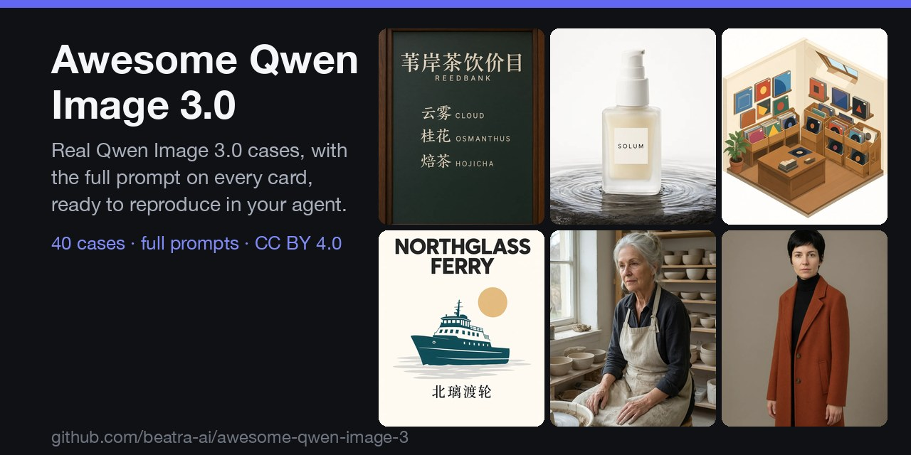
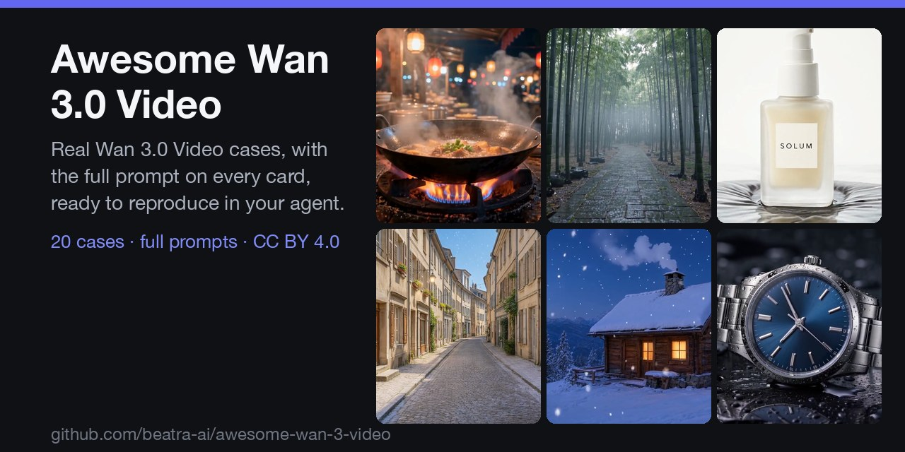

# Beatra

AI images, video, music, and voice for the coding agent you already use. Install a skill, describe what you want, and it renders on Beatra.

给你正在用的 Coding Agent 加上 AI 图片、视频、音乐和配音：装一个 Skill，说清楚想要什么，Beatra 就会帮你生成。

いつものコーディングエージェントで、AI の画像・動画・音楽・音声を。スキルを入れて作りたいものを伝えれば、Beatra が生成します。

```bash
npx skills add beatra-ai/ai-media-generator-skill
```

Then ask your agent: *"Turn this product photo into a 5-second clip with a slow push-in."*

> [!NOTE]
> Every skill is free to install; rendering uses Beatra credits. Works with Claude Code, Cursor, Codex, Windsurf, Cline, and OpenClaw.

## Prompt libraries

| [](https://github.com/beatra-ai/awesome-qwen-image-3) | [](https://github.com/beatra-ai/awesome-wan-3-video) |
| --- | --- |
| **[Awesome Qwen Image 3.0](https://github.com/beatra-ai/awesome-qwen-image-3)**<br>40 cases · full prompts · CC BY 4.0 | **[Awesome Wan 3.0 Video](https://github.com/beatra-ai/awesome-wan-3-video)**<br>20 cases · full prompts · CC BY 4.0 |

## Skills

### Images (8)

| Skill | What it does |
| --- | --- |
| [ai-media-generator-skill](https://github.com/beatra-ai/ai-media-generator-skill) | Create AI images, videos, music, and voice-over from one Agent Skill. |
| [ai-logo-maker-skill](https://github.com/beatra-ai/ai-logo-maker-skill) | Turn a brand name, industry, or reference image into logo concepts and a scalable brand mark. |
| [ai-poster-maker-skill](https://github.com/beatra-ai/ai-poster-maker-skill) | Turn an event description, a product photo, or brand references into an event poster, promo banner, or social media graphic with clear visual hierarchy, category-matched style, and space kept for text. |
| [ai-image-generator-skill](https://github.com/beatra-ai/ai-image-generator-skill) | Generate, compose, and edit product images, brand visuals, posters, social graphics, illustrations, and photo variations. |
| [photo-to-anime-skill](https://github.com/beatra-ai/photo-to-anime-skill) | Turn a photo into anime, manga, comic, cartoon, watercolor, clay, or 3D character art while the subject stays recognizable, and reuse the same look across a whole set. |
| [ai-headshot-generator-skill](https://github.com/beatra-ai/ai-headshot-generator-skill) | Turn a casual selfie into a professional headshot with a new background, business attire, and studio lighting for resumes, company websites, career profiles, and social media. |
| [ai-image-realism-skill](https://github.com/beatra-ai/ai-image-realism-skill) | Make existing AI portraits, product images, and marketing visuals look more natural by fixing plastic skin, malformed hands and faces, repeated textures, and inconsistent lighting. |
| [ai-storyboard-generator-skill](https://github.com/beatra-ai/ai-storyboard-generator-skill) | Turn a script, scene, or ad brief into a practical shot list and one to four storyboard key-frame images. |

### Video (3)

| Skill | What it does |
| --- | --- |
| [talking-avatar-video-skill](https://github.com/beatra-ai/talking-avatar-video-skill) | Turn one portrait and a short script into a talking avatar video. |
| [ai-video-generator-skill](https://github.com/beatra-ai/ai-video-generator-skill) | Generate, animate, edit, and extend short AI videos for ads, product stories, social posts, b-roll, transitions, and cinematic concepts. |
| [viral-video-remake-skill](https://github.com/beatra-ai/viral-video-remake-skill) | Break a short video that worked into its hook, beats, and call to action, then rebuild that structure around your own subject as a shot list, beat frames, and narration, delivered as one vertical clip or as segmented sources with captions and a timecoded edit list. |

### Music & Voice (7)

| Skill | What it does |
| --- | --- |
| [ai-music-generator-skill](https://github.com/beatra-ai/ai-music-generator-skill) | Turn a theme, lyrics, or reference audio into songs, instrumentals, and soundtracks. |
| [lyrics-to-song-skill](https://github.com/beatra-ai/lyrics-to-song-skill) | Turn full lyrics, a rough draft, or a hook into a structured song with clear sections, style, and vocal direction. |
| [ai-podcast-voiceover-skill](https://github.com/beatra-ai/ai-podcast-voiceover-skill) | Turn an article, notes, or a finished script into a solo podcast episode with a consistent host voice, natural pacing, pronunciation control, and an MP3 you can publish. |
| [ai-voiceover-generator-skill](https://github.com/beatra-ai/ai-voiceover-generator-skill) | Pick or reuse a voice, turn scripts into narration ready for editing, plan ordered long-form or multilingual audio, and create a reusable custom voice. |
| [multilingual-voiceover-skill](https://github.com/beatra-ai/multilingual-voiceover-skill) | Create reviewable voice-over audio for each language from your per-language scripts, with voices cast for each market, pronunciation and timing pilots first, and delivery organized by language and segment. |
| [ai-voice-cloning-skill](https://github.com/beatra-ai/ai-voice-cloning-skill) | Create a reusable personal or brand voice from a clean audio sample, give it a memorable name, and hear it in a short test reading. |
| [ai-audiobook-generator-skill](https://github.com/beatra-ai/ai-audiobook-generator-skill) | Turn a final manuscript or course text into ordered chapter audio with one narrator, a representative sample chapter first, and focused refinements. |

### E-commerce & Social (5)

| Skill | What it does |
| --- | --- |
| [ai-product-photography-skill](https://github.com/beatra-ai/ai-product-photography-skill) | Turn a real product photo into ecommerce studio photos and lifestyle scenes. |
| [ecommerce-product-images-skill](https://github.com/beatra-ai/ecommerce-product-images-skill) | Turn real product photos and confirmed SKU facts into a matching ecommerce image set: a hero image, feature visuals, lifestyle scenes, size views, and in-box images. |
| [wechat-article-cover-skill](https://github.com/beatra-ai/wechat-article-cover-skill) | Turn an article title, topic, or reference image into a WeChat Official Account cover, article hero image, or supporting visual, with space kept for the headline and focused refinement. |
| [xiaohongshu-cover-maker-skill](https://github.com/beatra-ai/xiaohongshu-cover-maker-skill) | Turn a photo or a topic idea into a vertical 3:4 Xiaohongshu cover with a clean background, a bold focal point, and text-safe areas for beauty, food, fashion, and lifestyle notes. |
| [xiaohongshu-copywriter-skill](https://github.com/beatra-ai/xiaohongshu-copywriter-skill) | Turn a product, experience, topic, or audience brief into Xiaohongshu title options, a readable note body, cover text, hashtags, and a natural comment starter. |

Full catalog: [beatra-ai/beatra-skills](https://github.com/beatra-ai/beatra-skills) — every Beatra skill in one repository.

## Models

<details>
<summary>Models (27) — image, video, music, voice, understanding</summary>

**Image** — Qwen Image 2.0 Fast, Qwen Image 3.0, Qwen Image 3.0 Pro, GPT Image 2.5 Flare, GPT Image 2.5 Sunburst, GPT Image 2, Wan Image 2.7 Fast, Qwen Image 2.0 Pro, Wan Image 2.7 Pro, MiniMax Image 01 Live

**Video** — Seedance 2.0 Mini, Wan 2.7, Wan 3.0 Video, MiniMax H3, HappyHorse 1.1, Seedance 2.0 Fast, Seedance 2.0, Wan 3.0 Video Prime, Seedance 2.5, Wan 2.7 Video Edit, HappyHorse 1.0 Video Edit

**Music** — Suno 6, MiniMax Music 3.0

**Voice** — MiniMax Speech 2.8 HD, MiniMax Speech 2.8 Turbo, MiniMax Voice Clone

**Understanding** — MiniMax M3
</details>

## Links

- Website — [beatra.ai](https://beatra.ai/?utm_source=github&utm_medium=profile&utm_campaign=beatra-ai)
- Docs — [docs.beatra.ai](https://docs.beatra.ai/?utm_source=github&utm_medium=profile&utm_campaign=beatra-ai)
- Console — [console.beatra.ai](https://console.beatra.ai)
- For AI agents — [llms.txt](https://beatra.ai/llms.txt) (index) · [llms-full.txt](https://beatra.ai/llms-full.txt) (every skill in one file)

- WeChat mini program (mainland China) · 国内用户微信扫码使用


